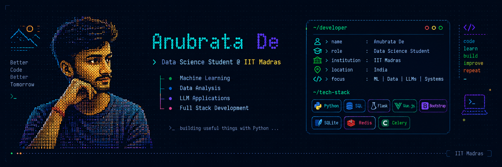

  

  

  
  
  
  

  Data science student at IIT Madras, building LLM agents, retrieval systems and the full-stack apps around them.

---

<!-- PROJECTS:START -->
## 🧩 Projects

15 projects, updated automatically from my repositories. Details for each are on <a href="https://anubrata.vercel.app/projects">my portfolio</a>.

### 🤖 LLM agents and apps

<table>
<tr>

<td width="50%" valign="top">

<h3>Your Text, Your Style</h3>

<em>Auto-Generate a Presentation</em>

Turns bulk text or Markdown into a PowerPoint deck in the style of any uploaded template, using the visitor's own LLM API key, which is never stored.

</td>

<td width="50%" valign="top">

<h3>Virtual Teaching Assistant</h3>

<em>Tools in Data Science (TDS), IIT Madras</em>

Answers student questions for the TDS course from scraped course content and Discourse forum posts, returning context-aware answers with references as JSON in under 30 seconds.

</td>

</tr>

<tr>

<td width="50%" valign="top">

<h3>LLM Agent Proof-of-Concept</h3>

<em>Browser-Based Multi-Tool Reasoning</em>

A minimal browser-based agent that reasons in a loop and calls tools as the model decides: Google search snippets, an AI Pipe proxy and sandboxed JavaScript, streaming its output to the page.

</td>

<td width="50%" valign="top">

<h3>Data Analyst Agent</h3>

<em>Automated Data Analysis &amp; Visualization API</em>

Takes a task in plain English with optional CSV, JSON or image attachments, then sources, analyses and visualises the data itself and returns the answer as JSON within strict time limits.

</td>

</tr>
</table>

### 🌐 Full-stack apps

<table>
<tr>

<td width="50%" valign="top">

<h3>Quiz Master V1</h3>

<em>Multi-User Exam Preparation Platform</em>

Admins manage subjects, chapters and quizzes; students take timed quizzes with a live countdown and auto-submit, then track their results.

</td>

<td width="50%" valign="top">

<h3>Placement Portal Application (PPA)</h3>

<em>Role-Based Recruitment Management System</em>

Lets admins, companies and students run campus recruitment: placement drives, applications, eligibility filtering, automated reminders, monthly reports and CSV export.

</td>

</tr>

<tr>

<td width="50%" valign="top">

<h3>ParkEase</h3>

<em>Smart Vehicle Parking Management System</em>

Role-based parking platform: admins manage lots, spots and users, and customers book and vacate spots in real time, with Redis caching and Celery jobs for reminders and monthly reports.

</td>

<td width="50%" valign="top"></td>

</tr>
</table>

### 🧠 Machine learning

<table>
<tr>

<td width="50%" valign="top">

<h3>Chest X-Ray Disease Classification</h3>

<em>DLGenAI NPPE 1 (Kaggle)</em>

Classifies chest X-rays by finding despite heavy class imbalance, comparing DenseNet-121, EfficientNet-V2-S and ViT-B/16 backbones with a class-balanced sampler and focal loss.

</td>

<td width="50%" valign="top">

<h3>Cinema Audience Forecasting Challenge</h3>

<em>Time Series Prediction</em>

Forecasts daily audience counts across theatres from booking, theatre and calendar data. Random Forest scored best (validation R² 0.51) and anchors a three-model ensemble.

</td>

</tr>

<tr>

<td width="50%" valign="top">

<h3>Movie Review Sentiment Prediction</h3>

<em>Multiclass classification (NLP)</em>

Classifies movie reviews as negative, neutral or positive with TF-IDF features and linear models, reaching 65% validation accuracy across the three classes.

</td>

<td width="50%" valign="top">

<h3>House Price Prediction</h3>

<em>Regression</em>

Predicts house prices from mixed categorical and numerical data for a Kaggle competition, comparing linear, tree and boosted models on R².

</td>

</tr>

<tr>

<td width="50%" valign="top">

<h3>Hotel Booking Cancellation Prediction</h3>

<em>Binary classification</em>

Predicts whether a hotel booking will be cancelled from customer, booking and stay features. Compared ten models; XGBoost reached 0.94 ROC-AUC on validation.

</td>

<td width="50%" valign="top">

<h3>Messy Mashup</h3>

<em>Noisy Music Genre Classification (DLGenAI)</em>

Classifies music genres from noisy mashups of instrument stems taken from different songs, handling tempo changes, cross-song mixing and background noise. Evaluated on Macro F1.

</td>

</tr>
</table>

### 📊 Business and data analysis

<table>
<tr>

<td width="50%" valign="top">

<h3>Portcast Data Analyst Intern</h3>

<em>Take-Home Case Study</em>

Traced a container's 7-day delay to a missed connection at Singapore, estimated what inaccurate ETAs cost a manufacturer each year, and reviewed an AI-written plan to integrate 50+ tracking feeds.

</td>

<td width="50%" valign="top">

<h3>Competitive Strategy and Financial Optimization for Clothing Business</h3>

<em>BDM Capstone Project</em>

Analysed a readymade garments shop's costs, revenue and market position from primary data, and proposed pricing, inventory and customer-retention strategies to improve working capital and profit.

</td>

</tr>
</table>
<!-- PROJECTS:END -->

---

## 🛠️ Tech Stack

### Languages

### Data and ML

### Back end and front end

### Areas

`Data Science` · `Machine Learning` · `LLM Applications` · `Data Analysis` · `REST APIs`

---

## 📊 GitHub Stats

  

  
  

  

  

---

## 🐍 Contribution Activity

---

  <a href="https://anubrata.vercel.app">Portfolio</a>
  ·
  <a href="https://www.linkedin.com/in/anubratade/">LinkedIn</a>
  ·
  <a href="https://github.com/anubrata-de">GitHub</a>
  ·
  <a href="https://www.instagram.com/anubrata.de/">Instagram</a>

